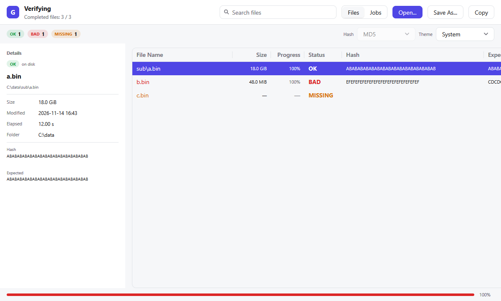
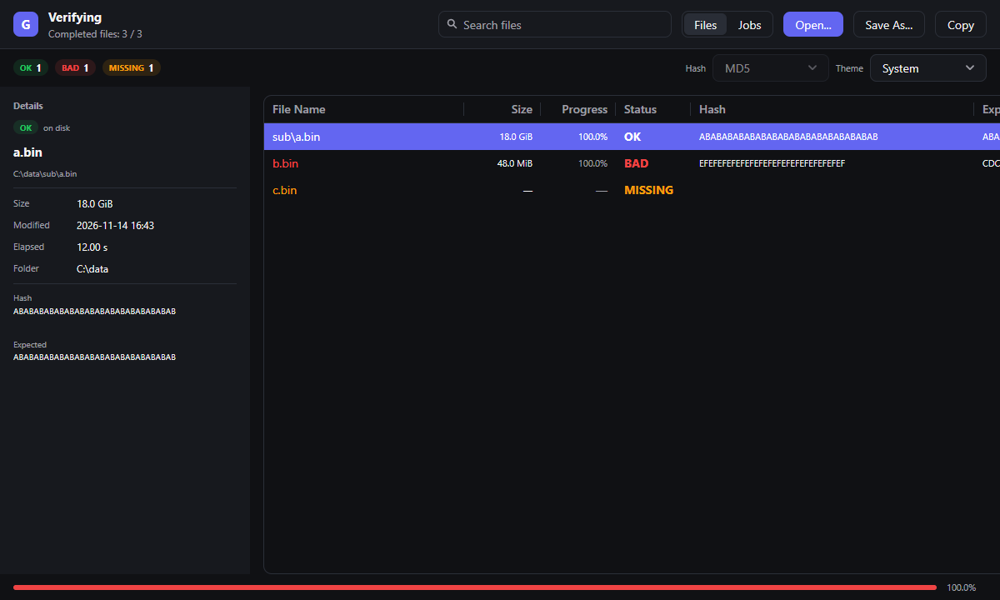

# GoSFV

**GoSFV** is a fast checksum creator and verifier for Windows, Linux and macOS: `.sfv`, `.md5`, `.sha1`, `.sha256` and `.xxh3`, with a color-coded file list, a job queue for folders, and the same engine in a scriptable headless mode. The desktop UI is native Go with [MyGo](https://github.com/egoist/mygo) 0.9.0 — no web view, no JavaScript, no C# runtime.

| Light | Dark |
| --- | --- |
|  |  |

## Features

- **Algorithms:** xxHash3-128 (default), CRC-32, MD5, SHA-1 and SHA-256.
- **Checksum files:** `.sfv`, `.md5`, `.sha1`, `.sha256` and `.xxh3`.
- **Both legacy syntaxes:** `HASH *filename` and CRC-32's `filename HASH`.
- **Legacy SFV byte order:** CRC-32 written with the opposite endianness is recognized and reported, not marked BAD.
- **System, light or dark:** the window follows the desktop by default; **View > Appearance** and the Theme selector in the header switch it with a short fade, and the choice is saved in `GoSFV.ini`.
- **Three UI modes:** the standard file list, a job queue that processes folder drops sequentially, and the compact "create checksum" window used by Explorer.
- **Headless mode:** scriptable create and verify with progress and exit codes.
- **Details sidebar:** the clicked file shows its status, size, modification date, hashes and timing; an ERROR row also shows the operating system's message for the last failure. A multi-selection gets a count, size, status breakdown, folder count and largest/smallest file. The summary runs off the main thread with a progress bar, and selections above 1000 files show their count only.
- **Live progress:** an overall bar with throughput and ETA; a **Size** and a **Progress** column in the table, with the percentage for each file as it is hashed; the row being hashed says **PROCESSING** in Status and the footer names the phase (Scanning, Processing, Rechecking, Paused, Done); pause/resume and stop sit in the footer, away from the Recheck buttons.
- **Native progress:** the overall run is mirrored on the Windows taskbar, the macOS Dock and Linux launchers that implement the Unity API.
- **Completion sound:** a clean verification plays the system alert when its window is not in front, so there is no audio file to ship.
- **Recheck:** re-hash the selected rows, only the failed ones (BAD/MISSING/ERROR), or the whole list. On an opened checksum the rows are compared with the expected digests; on a list created by dragging files the hashes are simply recomputed. **File > Recheck All** is F5, and the status bar has a Recheck button that keeps its place (disabled) while a run is in progress. ERROR rows are retried even if they failed during a stopped run, and the sidebar plus the Status tooltip show why a row failed again. A stopped run leaves unfinished rows waiting, and Recheck All hashes them again. Clicking the empty area below the rows clears the selection.
- **Live sorting:** when the order is by Progress, Status, Time, Hash or Size, the list re-sorts as files change during a run (up to 100,000 rows; a larger list sorts on the next header click). Progress is a plain percentage order; sort by Status to group the rows that say PROCESSING.
- **Filtering:** instant name search, status filter, and duplicate detection by checksum.
- **Bad-file tools:** move BAD/ERROR files into `_BAD_FILES`, rename them to `*.CORRUPT`, or generate `.bat` scripts to delete them or resolve duplicates.
- **Portable settings:** `GoSFV.ini` beside the executable; legacy key names from the original Windows tool are still read.
- **Explorer integration:** right-click files or folders to create a checksum; checksum extensions open in GoSFV when they are not already associated with another application. Everything is registered under `HKCU`, so no elevation is needed.

## Checksum format

An `.sfv` line is `FILENAME<whitespace>CHECKSUM`, and the checksum is the
numeric CRC-32 as eight hexadecimal digits, most significant digit first. That
is the order cksfv, QuickSFV and 7-Zip write, and what other tools expect, so
GoSFV always writes it:

```text
CBF43926 *file.bin     CRC-32 of "123456789"
```

Reading also accepts the byte-reversed spelling (`2639F4CB *file.bin`). Old
.NET SFV tools printed the raw bytes of `System.IO.Hashing.Crc32`, which are
little-endian, and files created that way still exist. The verifier recognises
them and reports the legacy order instead of marking the file BAD.
New files are never written reversed: the standard order is the only form every
tool agrees on.

## Performance

GoSFV is designed for throughput on the disk where the files live. Hash paths
use the assembly/SIMD implementations of the Go runtime and xxh3; the checksum
text codec uses a portable SWAR/table path, with an optional SIMD build.

### Hashing

The hashers are the Go standard library and `zeebo/xxh3`, all of which are assembly/SIMD accelerated:

| Algorithm | Backend |
| --- | --- |
| xxHash3-128 | `github.com/zeebo/xxh3`, AVX2/AVX-512 assembly |
| CRC-32 (IEEE) | `hash/crc32`, PCLMULQDQ on amd64, CRC instructions on arm64 |
| SHA-1 / SHA-256 | `crypto/sha1`, `crypto/sha256`, runtime block assembly including SHA-NI |
| MD5 | `crypto/md5`, runtime block assembly |

`go test -bench BenchmarkAlgorithms ./internal/hasher` on the development machine (Go 1.27, 8 MiB buffer):

```text
BenchmarkAlgorithms/XXHASH3   49707 MB/s   0 allocs/op
BenchmarkAlgorithms/CRC32     31639 MB/s   0 allocs/op
BenchmarkAlgorithms/SHA1       2290 MB/s   0 allocs/op
BenchmarkAlgorithms/SHA256     2191 MB/s   0 allocs/op
BenchmarkAlgorithms/MD5        1012 MB/s   0 allocs/op
```

### Read/hash overlap

Reading a block and then hashing it in the same goroutine leaves the disk
idle while the hash runs. For MD5, SHA-1 and SHA-256 on files of 16 MiB or
more, each worker has a reader goroutine and two ping-pong buffers: the
reader has the next block ready while the worker hashes the current one.
xxHash3 and CRC-32 keep their existing paths.

`go test -bench BenchmarkPipeline ./internal/engine` with a cached 48 MiB file:

| Algorithm | Serial | Overlapped |
| --- | ---: | ---: |
| MD5 | 855 MB/s | 1000 MB/s |
| SHA-1 | 1668 MB/s | 2150 MB/s |
| SHA-256 | 1544 MB/s | 1896 MB/s |

Hashing stays on the worker goroutine, so the digest is byte-identical: an
18 GiB SHA-256 pair matched the serial output byte for byte.

### Many-file verification

`runner.Verify` used to stat every checksum entry in one goroutine; on 20k
files that was 60–70% of the wall time. Entries are now stat'ed by GOMAXPROCS
workers (one on sequential media). A 20k-file verify on the development
machine went from a 663 ms median to 498 ms, with the same status and size
handling.

CRC-32 on one 64 MiB file, cached, with the default worker count on a
20-thread machine (`go test -bench BenchmarkCRC32 ./internal/engine`):

```text
BenchmarkCRC32OneWorker   4578 MB/s   1 worker
BenchmarkCRC32AllCores    6559 MB/s   20 chunk workers, 1 file
```

The parallel CRC run does more than one core's work on one file and produces
the same `.sfv` value; the limit is the read path, not the checksum.

### CRC chunk size

`DefaultCRCChunkSize` is 8 MiB. The engine also accepts
`Options.CRCChunkSize` for tests and embedders. Chunks are never smaller than
that, but the worker count caps them: a 512 MiB file with 20 workers gets 20
chunks of 25.6 MiB, not 64 chunks.

A 20 MiB file, cached, 20 logical cores (`BenchmarkCRCChunkSizes20MiB`):

| Minimum chunk | Chunks / workers | Throughput |
| --- | --- | --- |
| 1 MiB | 20 / 20 | 3978 MB/s |
| 2 MiB | 10 / 10 | 4215 MB/s |
| 4 MiB | 5 / 5 | 4233 MB/s |
| **8 MiB** | **2 / 2** | **5086 MB/s** |
| 16 MiB | 1 / 1 | 3641 MB/s |

On a 512 MiB file, 1–16 MiB minimums all produce the 20-chunk cap, so they
measure within noise of each other (about 3.5–4.5 GB/s); letting the cap use
fewer but larger chunks (32–64 MiB) reached 4.4–5.1 GB/s on the cached file,
but that leaves cores idle on mid-size files. 8 MiB was the best compromise:
two chunks for a 20 MiB file and full parallelism from roughly 160 MiB up.

The end-to-end engine is I/O bound, so a real run is bounded by the disk, not the hash. On a cached 8 MiB file the xxHash3 path measures about 1.7 GB/s through `os.File`, including open, read and result handling, with 15 allocations for the entire run. The pure hasher reaches 49.7 GB/s; the read path is the limit.

### Optional: Go 1.27 SIMD hex codec

Go 1.27 added the experimental `simd` and `simd/archsimd` packages. They can
accelerate the hexadecimal codec that parses and writes checksum text:

```powershell
powershell -ExecutionPolicy Bypass -File build.ps1 -Simd
# or:
$env:GOEXPERIMENT = "simd"
go build -o GoSFV.exe .
```

Release binaries and `go install` use the portable table/SWAR codec. The SIMD
build is opt-in because the end-to-end difference is within noise for normal
runs; it only matters when parsing or writing very large checksum lists. The
hash algorithms use their assembly/SIMD implementations either way; the
experiment only touches the hexadecimal conversion.

### Scheduling: one file per core, and one file on all cores when the algorithm allows it

- The normal pool creates `runtime.GOMAXPROCS(0)` workers (unless HDD/network mode forces one). Each worker hashes **one file at a time**. With 100 files and 20 cores, 20 files are in flight; with 4 files and 20 cores, 4 files are in flight.
- When there are **fewer files than cores** and the algorithm is **CRC-32**, GoSFV splits each file into chunks of at least 8 MiB and hashes the chunks on all workers. The block CRCs are combined with the same GF(2) matrix algorithm zlib uses (`crc32_combine`), so the resulting `.sfv` is exactly what a single-threaded tool would produce. A 20 GiB `.sfv` verification can use every core; a 20 MiB file uses two chunks rather than twenty.
- MD5, SHA-1, SHA-256 and xxHash3 are **sequential digests**. There is no way to split one file's bytes among N cores and combine the pieces into the standard digest; doing so would produce a checksum no other tool recognizes. For those algorithms a single file uses one core, and extra cores are intentionally idle rather than producing an incompatible hash. Multiple files still use one core each.

This is the honest limit of standard checksum formats. The GUI and CLI both follow it.

### Idiomatic Go interfaces

- `hasher.Kind.New() hash.Hash`: the engine hashes through the standard `hash.Hash` interface, which embeds `io.Writer`. Any implementation can be plugged in.
- `*os.File` implements `io.Reader` and `io.ReaderAt`; the CRC chunk path uses `io.ReaderAt` so chunks never share a file pointer.
- `checksum.ParseFile` opens an `io.Reader` and calls `checksum.ParseReader`; `checksum.WriteFile` calls `checksum.WriteTo(io.Writer, ...)`. The parser, writer and CLI compose with files, pipes and buffers without special cases.
- Optional behavior is a consumer-owned interface: `engine.Options` takes callbacks, `runner.Options` takes the same progress/files hooks, and the UI and CLI are two adapters over the same runner.

(Go 1.27 does not add a `hash.Hasher`; `hash.Hash` remains the standard interface. `hash/maphash.Hasher[T]` is the generic helper for map seeds, not file digests.)

### Allocation discipline

- One hasher and one read buffer per worker, reused for every file.
- One atomic increment per file hands out work; there is no channel per file.
- Results live in a preallocated slice; finished work is published with an atomic flag.
- Digests are written into a single result arena. The UI and the CLI keep slices into that arena instead of allocating a byte slice per file.
- The checksum parser decodes all hashes into one arena and allocates only the filename strings the list needs.
- UI updates are batched at 100 ms; the table is virtualized by MyGo and builds only the visible rows.

### Scanning and I/O

- Filters use `filepath.Match`; relative paths use `filepath.Rel`; deduplication is a map of cleaned paths.
- Recursive walking is the measured exception. On Windows it uses the Win32 directory listing (`internal/scanner/walk_windows.go`), which already carries attributes and size. `filepath.WalkDir` calls `DirEntry.Info()` (a separate stat) per file; on a 50,000-file, 200-directory tree this measured **2.87–3.01 s with `WalkDir` versus 0.14–0.15 s with the directory-listing walker** (304k versus 201k allocations). Other systems use `os.ReadDir`. The walker sits behind the same `Collect` API, so the rest of the app does not know which one ran.
- Files are opened with `os.Open` and read with `os.File.Read`. The parallel CRC path uses `os.File.ReadAt`, which is safe from several goroutines and maps to the platform's positional read. A custom Win32 handle reader was benchmarked on a fixed 256 MiB file (`BenchmarkFixedFile`) and did not beat `os.File`; the standard-library reader stays.
- The engine uses one sequential reader (8 MiB buffer) for a mechanical disk or network share, and one reader per `GOMAXPROCS` worker (about 1 MiB each) for flash.
- Custom code is kept only where it measured faster or the standard library has no equivalent: the directory-listing walker, the CRC-32 block combiner, rotational-drive detection, the Explorer registry entries, the checksum-format parser, and the SIMD/SWAR hex codec.
- Drive type comes from `IOCTL_STORAGE_QUERY_PROPERTY` on the volume, then the physical disk when BitLocker or RAID hides the volume, then the device product name. A device that refuses every query is treated as flash; `Options > Processing Mode` overrides this.

## Build

Requirements: Go 1.27.3 or newer. The `go` command downloads the toolchain `go.mod` asks for when the installed one is older.

```powershell
go build -o GoSFV.exe .
# or, with the same flags the release script uses:
powershell -ExecutionPolicy Bypass -File build.ps1
```

### Go install

The main package is at the module root, so `go install` works on Windows,
Linux and macOS without cloning:

```bash
go install github.com/lrweck/gosfv@latest
```

The binary is installed as `gosfv` (`gosfv.exe` on Windows) in
`$(go env GOPATH)/bin`, usually `%USERPROFILE%\go\bin` on Windows. `go install`
builds the same portable codec as the release binaries; the hash algorithms
keep their assembly/SIMD implementations. On Linux the GUI still loads the
system GTK 3 libraries at runtime; `-headless` needs neither a display nor
those libraries.

Packaged app with MyGo (the CLI is pinned as a tool in `go.mod`):

```powershell
go tool mygo build
# build/windows-amd64/GoSFV.exe and gosfv-setup-1.1.11-amd64.exe
```

## Usage

### GUI

- Drop files or folders to create checksums, or drop a single checksum file to verify it.
- The header keeps search, the **Files / Jobs** switch and the primary actions; the counts below it are color-coded chips.
- Click a row to open its details in the sidebar; select several for a summary. Hide it with **View > Show Details Sidebar**.
- Switch to **Mode > Job Queue Mode** and drop folders; each folder becomes a job whose checksum file is written beside it.
- Select rows for copy, rename, delete, or moving bad files. **Ctrl-click** adds or removes a row, **Shift-click** extends from the last chosen row, and **Ctrl+A** selects all; clicking the empty space below the rows clears the selection.
- Pick **View > Appearance** (or the Theme selector) to follow the system, or force light or dark.
- The **Size** column shows each file's size and **Progress** shows its live percentage while it is being hashed; the bar at the bottom is the whole run.
- The same overall progress appears on the taskbar (Windows), Dock (macOS) or launcher (Linux).
- A verification where every file matched beeps with the system sound if the window is in the background.
- Right-click a row for **Recheck Selected** / **Recheck Failed** / **Recheck All**, use the Recheck button in the status bar, or **File > Recheck All** (F5) to hash again; on an opened checksum the rest of the list and its expected hashes stay as they are, while a created list just recalculates the hashes. An ERROR row is always attempted again, and if it fails once more the sidebar and the Status tooltip name the reason.
- After **Stop**, the rows that had no result stay waiting; use **Recheck All**, or select them and use **Recheck Selected**, to hash them again. This works for a stopped verification and for a stopped creation.
- Clicking the empty space below the rows clears the selection; clicking a row keeps it.
- While a run is active, **Pause/Resume** and **Stop** sit in the footer, and **Mode > Pause / Resume Run** and **Stop Run** bind them to F7 and F8. While paused the elapsed time and ETA freeze and the throughput reads `0.0 MB/s`; resuming continues from where it stopped.
- Use **Options > System Integration** to add or remove Explorer entries.

### Command line

```text
GoSFV.exe -headless <checksum-file>
GoSFV.exe -headless -create <files-or-folders>
GoSFV.exe -headless -create -algo sha256 -o digests.sha256 C:\Builds
GoSFV.exe -create -o checksums.sfv C:\Backups\2026
```

Options (the parser is [`spf13/pflag`](https://github.com/spf13/pflag), so
`-headless` and `--headless` are the same flag):

| Option | Meaning |
| --- | --- |
| `-create` | Create checksums. Without `-headless`, opens the compact create window. |
| `-headless` | No window; print a progress bar on stderr and a summary on stdout. |
| `-quiet` | No progress bar (the summary is still printed). |
| `-algo NAME` | `xxh3`, `crc32`, `md5`, `sha1` or `sha256`. |
| `-o PATH` | Output checksum file. |
| `-ini PATH` | Configuration file. |
| `-theme NAME` | Start the window in `system` (default), `light` or `dark`. |
| `-version` | Print the version. |
| `-h`, `--help` | Usage, generated from the flag definitions. |

Exit codes: `0` when every file is OK, `1` when anything is BAD, MISSING or ERROR (or the run was stopped), `2` for usage or setup errors.

The terminal UI is built with
[`schollz/progressbar/v3`](https://github.com/schollz/progressbar/v3): a spinner
while scanning, then bytes, throughput, elapsed time and ETA. Progress goes to
stderr, so redirecting stdout keeps the summary clean. When stderr is not a
terminal, or with `-quiet`, the bar is omitted.

Example:

```text
> GoSFV.exe -headless C:\LinuxDistros\ubuntu.sha256
Verifying C:\LinuxDistros\ubuntu.sha256 (SHA-256, SSD/Parallel)
------------------------------------------------
Total: 4
OK: 4
BAD: 0
MISSING: 0
ERROR: 0
Time: 12 ms
------------------------------------------------
```

## Configuration

`GoSFV.ini` sits next to the executable. The keys keep the names of the
original Windows tool, so an existing INI can be copied over as `GoSFV.ini`:

```ini
[GoSFV]
TimeTab=0
ShowThroughputStats=0
ShowFilterPanel=0
ShowAdvancedBar=0
ShowDetailsPanel=1
ShowFullPaths=0
ShowHashCol=1
ShowExpectedHashCol=1
LockColumns=1
PathStorageMode=Relative
ProcessingMode=Auto
EnableChecksumComments=0
PathPrefix=
IncludePattern=
ExcludePattern=
ScanRecursive=1
Signature=L33T
Theme=System
DefaultAlgo=XXHASH3
ColumnOrder=Name:0,Hash:1,Status:2
ColumnWidths=Name:300,Hash:430,Status:90
```

`ProcessingMode` accepts `Auto`, `HDD` (one reader) and `SSD` (parallel). `PathStorageMode` accepts `Relative` and `Absolute`. `Theme` accepts `System`, `Light` and `Dark`; the legacy `DarkMode=0/1` key is still read. The legacy `UseAbsolutePaths` and `OptimizeForHDD` keys are also still read.

## How it is organized

```text
main.go                 GUI/headless dispatch
internal/
  hasher/               algorithm names, hashers, benchmarks
  hexfmt/               SIMD (Go 1.27) and portable hex codecs
  checksum/             parser, writer, endian-aware verification helpers
  scanner/              Win32/ReadDir walker, filters, common base, wildcard matching
  engine/               worker pool, pause gate, progress, result arena
  runner/               scan -> hash -> status pipeline used by GUI and CLI
  model/                File, Job and status types
  settings/             portable INI
  drive/                HDD/SSD detection
  badtools/             move/rename and .bat generators
  shell/                Explorer registry integration
  cli/                  flags (pflag), headless runner, terminal progress and report
  gui/                  MyGo state, modern shell, palettes, menus, actions and job queue
```

The flow is:

```text
drop / open / CLI
  -> runner scans or parses
  -> files handed to the UI (and tasks built)
  -> engine hashes with N reusable workers
  -> results published atomically
  -> UI applies batches on the main thread every 100 ms
  -> save / verify report
```

The GUI and the CLI share the runner, so status rules, CRC endianness and progress counts cannot drift.

## Tests

```powershell
go test ./...
# optional: also exercise the experimental SIMD hex codec
$env:GOEXPERIMENT = "simd"; go test ./...
```

The tests cover known hash vectors, hex round trips (including fuzz), both checksum syntaxes, legacy CRC endianness, parser allocation bounds, scanner behavior, filtering, CRC chunk combination, engine cancellation and progress, the runner, the read/hash overlap at buffer-boundary sizes, parallel checksum stats, settings and theme compatibility, command-line parsing (single- and double-dash flags, `--`, invalid values), the details snapshot (single-file stat, multi-selection summary, cancellation and the size limit), and the view in both palettes with `ui.Tester`.

`TestRenderPreview` writes the light and dark renders used in this README without a display:

```powershell
$env:GOSFV_PREVIEW_DIR = "$env:TEMP"; go test ./internal/gui -run TestRenderPreview
```

## Design notes

- The UI is MyGo native; the layout and the theme follow the desktop.
- Explorer registration uses `HKCU` only and does not copy the executable into `%LOCALAPPDATA%`.
- Windows taskbar progress and system sounds are not wired in; the in-window progress bar, throughput and colors replace them.
- When a disk refuses every hardware query, the GUI assumes flash. Force the mode with **Options > Processing Mode**.
- The generated scripts are Windows `.bat` files.
- Job mode keeps completed jobs until **Mode > Clear Completed Jobs**.

## License

GoSFV is licensed under the **GNU General Public License v3.0**. See
[LICENSE](LICENSE) and [NOTICE](NOTICE).

## Attribution

GoSFV began as a Go reimplementation of SharpSFV
(https://github.com/Wishwanderer/SharpSFV), GPL-3.0. See [NOTICE](NOTICE) for
that attribution and for the third-party components.

MyGo: MIT, https://github.com/egoist/mygo.
xxh3: BSD-2-Clause, https://github.com/zeebo/xxh3.
